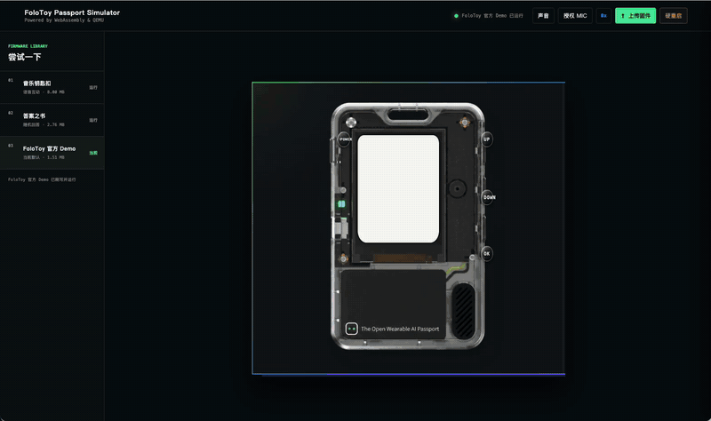

# FoloToy AI Passport 模拟器

[](./public/assets/demo/folotoy-emu.mp4)

> 点击可观看视频！

在浏览器中运行 FoloToy AI Passport 的 ESP32-C3 固件。项目基于
ESP-EMU v0.42.0、WebAssembly 和 QEMU，直接模拟开发板外设，普通固件无需为浏览器单独适配。

默认固件来自 [`FoloToy/ai-passport`](https://github.com/FoloToy/ai-passport)
的 `c73254e2` 提交。

## 模拟器说明

目前支持：

- ST7789P3 屏幕
- 屏幕截图复制、屏幕视频录制和下载
- UP、DOWN、OK 和 POWER 按键
- 扬声器和麦克风
- ESP32-C3 Wi-Fi、TCP、UDP、DNS 和 ICMP
- CPU 寄存器、UART 和网络检查器
- 本地固件上传和 FoloToy 社区固件导入

页面内置“音乐钥匙扣”“答案之书”“FoloToy 官方 Demo”和“飞书日程助手”
四个固件。

可通过 URL 的 `id` 参数指定启动时加载的内置固件，例如：

```text
http://127.0.0.1:4190/?id=2
```

仅接受以下固定值：

| `id` | 固件 |
| --- | --- |
| `1` | 音乐钥匙扣 |
| `2` | 答案之书 |
| `3` | FoloToy 官方 Demo |
| `4` | 飞书日程助手 |

参数缺失或不是上述值时加载 FoloToy 官方 Demo。

按键也可使用键盘操作：

| 设备按键 | 键盘 |
| --- | --- |
| UP | `↑` |
| DOWN | `↓` |
| OK | `Enter` |
| POWER | `P` |

声音需要先点击页面上的“声音”。麦克风需要单独授权，并且只能在
`localhost` 或 HTTPS 页面使用。

## 脚本串口调试（AT 指令）

不必打开 UART 检查器或模拟鼠标点击。页面运行后，同源开发脚本可以调用：

```js
const serial = window.aiPassportSimulator.serial;
const reply = await serial.command("AT+NET?", {
  match: "CAMPUS_NET", // 换成当前固件实际的返回标记
  timeoutMs: 3000,
});
console.log(reply.text);
await serial.command("ok"); // 发送一行，默认以 CR 结束
serial.write(new Uint8Array([65, 84, 13])); // 原始字节，不附加结束符
const cursor = serial.cursor;
await serial.waitFor(/OK\r?\n/, { since: cursor, timeoutMs: 3000 });
const output = serial.read({ since: cursor });
```

`command` 仅发送固件串口内容，不解析或执行 JavaScript。支持 `terminator`（`\r`、`\n`、`\r\n` 或空串）；不指定 `match` 时只确认已交给运行时，**不代表固件已处理**。指定 `match` 后必须收到匹配输出，否则超时报错；同一时刻只允许一条等待回包的 `command`。也可传入 `AbortSignal`。`read` 返回原始文本与字符游标；默认保留最近250,000个字符，过期游标报错。清空、重载、运行失败和销毁都会取消等待。

接口复用现有 `uart-input`/`uart` 通道；当前 WASM 将输入送往 UART0 和 USB Serial/JTAG，两者不能单独选择。读取仅覆盖运行时实际提供的输出：固件是否实现指令、所用控制台是否有回包，都必须验证。运行状态不等于应用完成开机，可先等固件的就绪标记。接口不自动回显输入、不开放HTTP串口端点，也不从URL执行指令。不要把密码或机器人地址放进公开脚本、日志或源码。

### Node 命令行（无需浏览器）

创建UTF-8的 `steps.json`：

```json
[
  {"command": "AT+NET?", "match": "CAMPUS_NET", "timeoutMs": 3000},
  {"command": "ok", "settleMs": 500, "screenshot": "home.png"}
]
```

```bash
node tools/serial-debug.mjs --firmware /path/to/full.bin \
  --commands-file steps.json --boot-ms 5000 --output-dir serial-output
```

每次启动独立的离线虚拟设备，使用现有QEMU、WASM和外设模型；不打开实体USB、不控制已打开的浏览器，也不建立网络桥接。指令不回显；输出按步骤返回JSON。`matched: null` 只表示发送步骤；带 `match` 的步骤缺少预期返回时以非零状态退出。`boot-ms`、`settleMs`、`timeoutMs` 在命令行中均为**虚拟毫秒**，浏览器API超时为实际毫秒。截图是240×320原始PNG，仅接受文件名，写入指定目录。网络、BLE等模拟限制仍然适用；配网和无线联调使用浏览器桥接或实机。

## 屏幕录制

固件运行后，点击设备右上角的“录屏”开始录制，按钮会显示已录制时长。
再次点击“停止”生成视频并下载；也可以通过“下载视频”链接再次保存。

视频为 240 × 320 的原始屏幕画面，随浏览器画面刷新采集，目标 60 FPS，不包含设备外壳、页面控件或声音。
浏览器支持时优先保存为 MP4，否则使用 WebM。录制时请保持页面在前台，
切换到后台可能降低帧率；刷新或关闭页面前，请先停止并保存视频。
视频在浏览器内生成，不上传服务器。全屏模式下也可使用录屏按钮。

## 流畅度与联网音频

- TCP 桥接允许多个数据包连续发送，并遵守固件接收窗口；支持累计确认、重传、窗口收缩与零窗口恢复。
- 按键立即传给固件，由固件识别单击、双击和长按；快速点击保持至少 75 ms 的虚拟按下时间，避免漏键。
- 运行线程按 160 MHz 虚拟时钟与真实时间同步，忙时每 6 ms 让出线程处理网络与输入，空闲时休眠。后台暂停后最多追赶 50 ms，避免快进。
- 显示使用 RGB565 查表转换并忽略未变化像素；浏览器每次只接收一份待显示画面，按屏幕刷新合并更新，避免积压旧帧。
- 支持 AudioWorklet 的浏览器在专用音频线程中连续播放，使用 80–180 ms 自适应缓冲；CPU 检查器可查看缓冲中断次数。旧浏览器保留音频缓冲调度回退。
- 固件本身的动画帧率、软件解码负载和电台源质量仍会影响效果。60 FPS 是录制采集目标，不能把固件没有生成的画面变成真实新帧。

可重复性能检查：`node tools/benchmark-simulator.mjs`；网络固定延迟确认对照：
`node tools/benchmark-network.mjs --baseline` 与 `node tools/benchmark-network.mjs`。

## 必要依赖

- Node.js 20 或更高版本
- npm
- 支持 WebAssembly、Web Worker 和 Web Audio 的现代浏览器，推荐最新版 Chrome 或 Edge
- Docker，可选，仅用于容器部署

项目没有第三方 npm 运行依赖，WASM 运行时和示例固件已经包含在仓库中。

## 本地运行

```bash
npm run prepare:emulator
npm start
```

打开 <http://127.0.0.1:4190>。

`prepare:emulator` 会检查固件、WASM 文件和开发板 ABI。日常开发确认文件没有变化后，
也可以直接执行 `npm start`。

如需让局域网设备访问：

```bash
HOST=0.0.0.0 PORT=4190 npm start
```

## 固件

点击“上传固件”可选择本地 `.bin` 文件，或粘贴
`https://ai-passport.folotoy.cn/plays/` 下的玩法详情链接。

也可以通过模拟器 URL 的 `play` 参数直接加载已发布的社区玩法，例如：

```text
http://127.0.0.1:4190/?play=100
```

页面会自动拉取玩法 100 的社区 Full Flash 镜像，完成校验后直接运行。

本地开发命令 `npm start` 会启用本地文件入口。`dist/` 发布包和 Docker
镜像默认关闭该入口，只允许从 FoloToy 社区加载经过服务端校验的固件。

本地固件需要满足以下条件：

- ESP32-C3 Full Flash 合并镜像
- 从地址 `0x0` 写入
- 不超过 8 MiB
- 包含 bootloader、分区表、应用和所需资源

上传的本地固件只保存在当前页面中，刷新后会恢复默认固件。

如需显式覆盖本地固件策略，可设置：

```bash
EMULATOR_ALLOW_LOCAL_FIRMWARE_UPLOAD=1 node server.mjs  # 启用
EMULATOR_ALLOW_LOCAL_FIRMWARE_UPLOAD=0 npm start        # 关闭
```

## 生产部署

先生成并校验 `dist/`：

```bash
npm test
npm run build
npm run verify:release
```

直接运行：

```bash
cd dist
HOST=0.0.0.0 PORT=4190 npm start
```

Docker 部署：

```bash
docker build -t ai-passport-emulator .
docker run --rm -p 4190:4190 ai-passport-emulator
```

健康检查地址为 `/healthz`。线上建议在反向代理层配置 HTTPS，并允许
`/api/emulator-network` 的 WebSocket 升级。

## 开发

主要目录和文件：

- `public/`：页面、样式和浏览器端运行代码
- `public/wasm/`：ESP-EMU WASM 和开发板外设模拟
- `server.mjs`：静态资源、社区固件接口和健康检查
- `logging.mjs`：结构化运行日志、请求 ID 和错误字段
- `network-bridge.mjs`：虚拟 Wi-Fi 网络桥
- `test/`：Node.js 单元测试
- `tools/`：构建和发布校验脚本

常用命令：

```bash
npm start                # 启动开发服务
npm test                 # 运行测试
npm run build            # 构建 dist/
npm run verify:release   # 校验发布文件
npm run start:dist       # 运行 dist/ 版本
```

前端没有额外构建步骤，修改 `public/` 后刷新浏览器即可。

## 已知限制

- CW2017 电量计尚未模拟，官方 Demo 会显示 `Battery [FAIL]`
- BLE 控制器尚未模拟，固件进入 BLE ROM 代码时会暂停并提示不支持
- 低功耗行为与真实硬件不完全一致
- 网络只支持 IPv4，不转发分片数据包
- 默认禁止访问内网、回环和保留地址

仅在可信的本地开发环境中，可允许模拟器访问内网：

```bash
EMULATOR_NETWORK_ALLOW_PRIVATE=1 npm start
```

## 小智 AP 配网固件的模拟适配

社区玩法 72（小智 AI 对话机器人）的已验证版本加载后，会出现“连接模拟 Wi-Fi”按钮。
点击后仅向本次虚拟 Flash 的空白 NVS 分区写入 `Emulator Host Bridge`，并重启固件。
固件随后通过现有网络桥接联网，进入小智设备激活流程。绑定需由使用者自行完成。
刷新页面重新下载固件会恢复原始配置；原始文件不被修改。

这属于按固件版本校验的配置适配，并非完整模拟手机连接 AP，也不是通用配网页面代理。
仅适用于 SHA256 为 `979f01d7fd762c590272017b8e9901e2b473f8a01653c384745a242365b7e923` 的镜像，其他版本不会显示按钮。
配置模板使用 ESP-IDF NVS 生成器从 `tools/xiaozhi-wifi.csv` 生成（V2，大小 `0x4000`），只包含虚拟网络配置，不含真实 Wi-Fi 密码。
